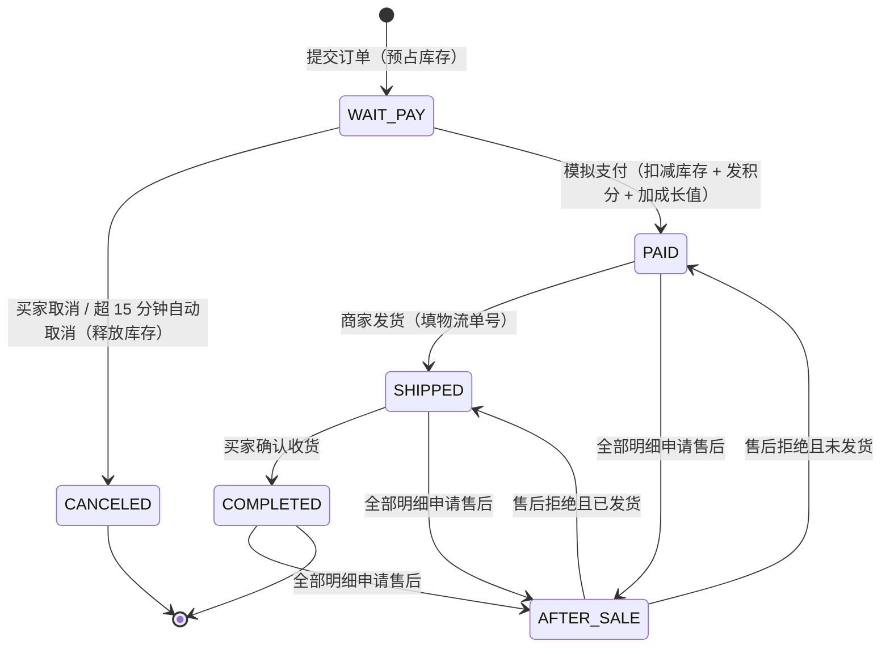
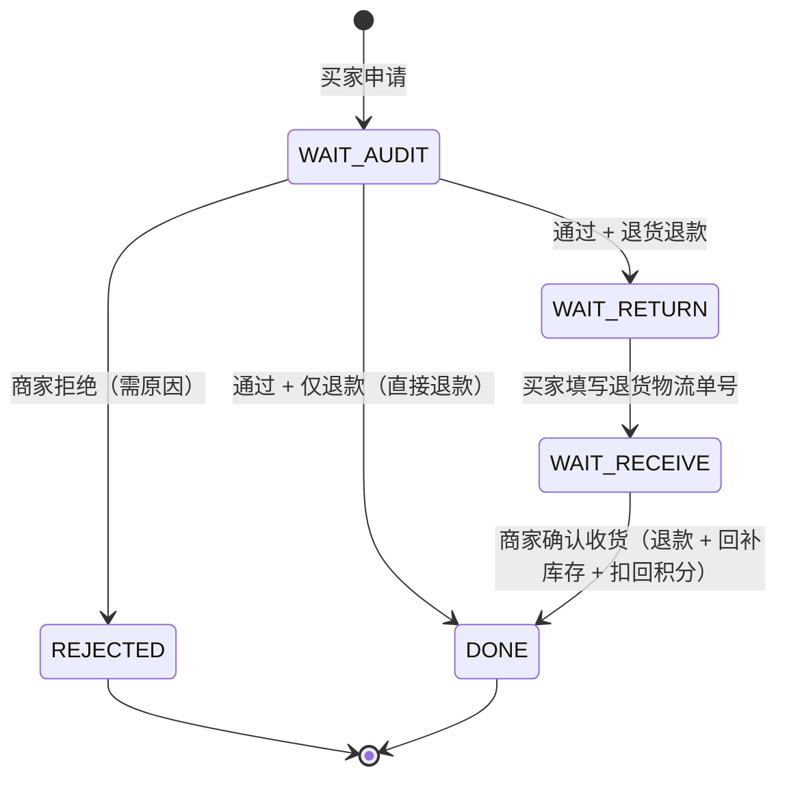

# 01 · 需求规格说明书（SRS）

| 项 | 内容 |
|---|---|
| 文档编号 | QGJ-SRS-01 |
| 版本 | v2.0.0 |
| 状态 | 基线（Baseline） |
| 日期 | 2026-10-22 |
| 对应代码 | `backend/` `frontend-web/` `frontend-h5/`（commit 见仓库 HEAD） |
| 上游文档 | 无（本文档为需求源头） |
| 下游文档 | 02 概要设计 · 03 详细设计 · 05 测试方案与报告 |

> **本文档是唯一的需求事实来源。** 所有设计、开发、测试条目都必须能回溯到本文档的编号（如 `O-03`、`AC-02`）。
> 每条需求都标注了**实现状态**，状态以当前代码为准，不以历史计划为准。

---

## 1. 项目背景与目标

### 1.1 背景

为区域槟榔品牌「青果纪」搭建一套自有电商系统，替代依赖第三方平台的销售方式。业务包含两块：

- **客户端（H5）**：消费者买货、查真伪、攒积分的入口，主要跑在微信内嵌浏览器与手机浏览器。
- **管理端（Web）**：商家在 PC 上处理商品、库存、订单、售后、会员的作业台。

选择自建而非 SaaS 的原因：**一物一码防伪积分**是品牌核心诉求，需要与包装上的唯一码打通，第三方商城无法满足。

### 1.2 目标

| 编号 | 目标 | 衡量方式 |
|---|---|---|
| G-01 | 打通「浏览 → 加购 → 下单 → 支付 → 发货 → 收货 → 售后」闭环 | 演示脚本 6.6 一次跑通 |
| G-02 | 库存不超卖 | 并发下单测试（TC-06）库存无负数、成功单数 ≤ 可售数 |
| G-03 | 会员体系可运营 | 五级等级 + 积分获取/消耗/回滚全链路可追溯 |
| G-04 | 双端代码彻底分离 | 前端工程独立构建部署，后端不再托管页面 |
| G-05 | 工程质量可交付 | 前后端均有格式化门禁 + 自动化测试；部署文档可复现 |

### 1.3 范围

**做**

- H5 客户端五个页面：首页、商品详情、购物车、订单、我的
- Web 管理端七个页面：登录、看板、商品、库存、订单、售后、会员
- 模拟支付（不接真实支付网关）、手工填物流单号
- 五级会员、消费积分、签到积分、扫码积分、积分流水
- H2（开发）/ MySQL（生产）双数据库支持

**不做（本期明确排除）**

| 项 | 原因 | 后续 |
|---|---|---|
| 真实支付网关 | 需企业资质与商户号 | 变更 C-05 候选 |
| 物流轨迹查询 | 需快递鸟等三方接口 | 变更候选 |
| 优惠券 / 拼团 / 分销 | 超出本期范围 | 变更候选 |
| 多商户 / 多租户 | 单品牌自营 | 不做 |
| 小程序端发布 | Taro 已预留编译目标 | 变更候选 |
| 收货地址簿 | 下单时直接填三字段 | 变更候选 |

---

## 2. 角色与权限

| 角色 | 端 | 登录方式 | 能力边界 |
|---|---|---|---|
| 游客 | H5 | 无需登录 | 浏览商品列表、商品详情 |
| 会员（买家） | H5 | 手机号 + 短信验证码 | 购物车、下单、支付、取消、确认收货、售后申请、签到、扫码、查积分 |
| 商家管理员 | Web | 账号 + 密码 | 看板、商品上下架、库存调整、订单发货、售后审核、会员积分调整 |

**权限实现方式**：两套令牌互不通用，均通过请求头 `X-Token` 传递；令牌前缀区分身份（`MBR-` / `ADM-`），后端拦截器按注解声明的 `LoginType` 校验。详见 03-2 第 4 章。

---

## 3. 系统能力全景

```mermaid
flowchart LR
    subgraph H5["H5 客户端（Taro + Vue3）"]
        H1[首页/商品]
        H2[购物车]
        H3[订单/支付]
        H4[售后申请]
        H5[会员中心]
    end

    subgraph WEB["Web 管理端（Vue3 + Element Plus）"]
        W1[数据看板]
        W2[商品管理]
        W3[库存管理]
        W4[订单管理]
        W5[售后管理]
        W6[会员管理]
    end

    subgraph API["后端（Spring Boot 3.5）"]
        A1["/api/** 客户端接口<br/>18 个"]
        A2["/admin-api/** 管理端接口<br/>14 个"]
        A3[业务服务层<br/>商品/会员/购物车/订单/售后/管理]
        A4[库存四原语<br/>预占·扣减·释放·回补]
    end

    DB[(H2 / MySQL)]

    H1 & H2 & H3 & H4 & H5 --> A1
    W1 & W2 & W3 & W4 & W5 & W6 --> A2
    A1 & A2 --> A3 --> A4 --> DB
```

---

## 4. 功能需求

**状态图例**：`✅ 已实现` 与本文档一致 · `⚠️ 部分实现` 与需求有差距（差距已注明） · `⬜ 未实现` 本期不做

### 4.1 会员与登录（U / V）

| 编号 | 需求 | 规则要点 | 状态 | 实现位置 |
|---|---|---|---|---|
| U-01 | 手机号验证码登录 | 验证码演示环境固定 `123456`；手机号 11 位且以 1 开头；**新手机号自动注册** | ✅ | `MemberServiceImpl#login` |
| U-02 | 登录态维持 | 登录返回 `MBR-` 前缀令牌，请求头 `X-Token` 携带 | ⚠️ | `TokenService`：令牌存进程内存，**无过期时间，重启即失效**（原计划 JWT 7 天，未落地） |
| U-03 | 当前会员信息 | 返回会员本体 + 等级值/等级名/积分倍率/折扣率 | ✅ | `GET /api/member/me` |
| U-04 | 收货地址簿 | 多地址增删改查、设默认 | ⬜ | 下单时直接填写三字段，无地址簿 |
| V-01 | 五级会员等级 | 成长值门槛 0 / 1,000 / 5,000 / 20,000 / 50,000；成长值 = 累计实付金额 | ✅ | `Member#level()` |
| V-02 | 等级权益 | 折扣与积分倍率按下表 4.2 | ✅ | `Member#discount()` `#pointRate()` |
| V-03 | 消费积分 | 支付成功发放 `round(实付 × 倍率)`；成长值 `+实付` | ✅ | `OrderServiceImpl#payOrder` |
| V-04 | 扫码积分 | 一码一积分，重复扫提示"该码已被使用"；每日上限 20 包；每包 +10 | ✅ | `MemberServiceImpl#scanCode` |
| V-05 | 每日签到 | 每日 +5 积分；同日重复签到被拒 | ⚠️ | `MemberServiceImpl#checkin`：**连续 7 天额外 +50 未实现** |
| V-06 | 积分兑换 | 积分商城、兑换下单、等级门槛商品 | ⬜ | 本期未开发（无积分商品表、无兑换接口） |
| V-07 | 积分流水 | 记录类型 `CHECKIN` / `SCAN` / `EARN` / `REFUND_BACK`，含来源备注 | ✅ | `PointsLog` + `/api/member/points/logs` |

### 4.2 商品与库存（P / S）

| 编号 | 需求 | 规则要点 | 状态 | 实现位置 |
|---|---|---|---|---|
| P-01 | 商品分类 | 单层分类字段（如"经典系列"），客户端可按分类筛选 | ✅ | `Product.category` + `GET /api/products?category=` |
| P-02 | 商品列表 | 仅展示上架商品，分页返回 | ✅ | `ProductServiceImpl#selectProductPage` |
| P-03 | 商品搜索 | 按名称模糊搜索 | ⬜ | 无搜索接口与前端入口 |
| P-04 | 商品详情 | 主图、副标题、销量、SKU 列表、可售库存 | ✅ | `GET /api/products/{id}` |
| P-05 | SKU 规格 | SKU 维度独立价格与库存，规格名如"10 包/袋" | ✅ | `ProductSku` |
| P-06 | 上下架 | 下架商品客户端列表不可见、详情不可访问、下单被拦截 | ✅ | `ProductServiceImpl#changeProductStatus` |
| S-01 | 库存结构 | `可售 = 总库存 − 锁定库存`，库存挂在 SKU 上 | ✅ | `ProductSku#availableStock()` |
| S-02 | 原子预占 | 同一订单多 SKU，任一不足则整单回滚 | ✅ | `ProductSkuRepository#lockStock`（条件更新） |
| S-03 | 支付扣减 | 支付成功：总库存 −n、锁定库存 −n | ✅ | `#deductStock` |
| S-04 | 取消释放 | 主动取消 / 超时取消：锁定库存 −n | ✅ | `#releaseStock` |
| S-05 | 防超卖 | 数据库条件更新 `WHERE total - locked >= n`，受影响行数为 0 即失败 | ✅ | 同上，无 Redis 层 |
| S-06 | 库存调整 | 幂等校验：`delta ≠ 0`、扣减后总库存不得为负；**要求留痕** | ⚠️ | `ProductServiceImpl#adjustStock`：留痕仅写日志，未落 `stock_flow` 表 |
| S-07 | 售后回补 | 退货退款完成后 `总库存 +n` | ✅ | `#restock`，仅 `RETURN_REFUND` 触发 |

### 4.3 购物车（C）

| 编号 | 需求 | 规则要点 | 状态 | 实现位置 |
|---|---|---|---|---|
| C-01 | 加购 | 同 SKU 合并数量；单次数量 1~999；下架商品拒绝加购 | ✅ | `CartServiceImpl#addCart` |
| C-02 | 查看 | 返回商品名、规格、单价、数量、小计 | ✅ | `CartServiceImpl#selectCart`（组装 `CartItemVo`） |
| C-03 | 修改 | 改数量（≤0 视为删除）；仅能操作自己的购物车项 | ✅ | `#updateCart` |
| C-04 | 结算金额 | 会员折扣 → 满 99 免运费，否则 +8；`应付 = 商品额 − 折扣 + 运费` | ✅ | `OrderServiceImpl#createOrder` |
| C-05 | 存储 | 服务端存储，多端同步 | ✅ | `cart_item` 表（按 `memberId`） |

### 4.4 订单（O）

| 编号 | 需求 | 规则要点 | 状态 | 实现位置 |
|---|---|---|---|---|
| O-01 | 创建订单 | 订单号 `QGJ + yyyyMMddHHmmss + 6 位序列`；收件人三字段必填、手机号格式校验 | ✅ | `OrderServiceImpl#createOrder` |
| O-02 | 库存预占 | 与订单创建同一事务，预占失败整单回滚 | ✅ | 同上（`@Transactional`） |
| O-03 | 模拟支付 | 点击即支付成功；非待付款状态重复支付被拒（幂等） | ✅ | `#payOrder` |
| O-04 | 订单状态机 | 见 5.1 | ✅ | `MallOrder.status` |
| O-05 | 取消订单 | 待付款可主动取消；超 15 分钟由定时任务自动取消；两者都释放库存 | ✅ | `#cancelOrder` `#cancelExpiredOrders` |
| O-06 | 订单列表 | 按状态筛选（ALL/WAIT_PAY/PAID/SHIPPED/COMPLETED/CANCELED/AFTER_SALE） | ✅ | `GET /api/orders?status=` |
| O-07 | 确认收货 | 仅 SHIPPED 可确认，重复确认被拒 | ✅ | `#confirmReceive` |
| O-08 | 发货 | 仅 PAID 可发货；物流单号非空 | ✅ | `#shipOrder` |
| O-09 | 自动确认收货 | 发货 15 天后自动 COMPLETED | ⬜ | 定时任务只处理超时未支付 |

### 4.5 售后（A）

| 编号 | 需求 | 规则要点 | 状态 | 实现位置 |
|---|---|---|---|---|
| A-01 | 申请入口 | PAID / SHIPPED / COMPLETED 三种订单状态可申请 | ✅ | `AfterSaleServiceImpl#applyAfterSale` |
| A-02 | 售后类型 | `REFUND_ONLY` 仅退款（限未发货）；`RETURN_REFUND` 退货退款 | ✅ | 同上，已发货/已完成订单仅退款被拒 |
| A-03 | 申请内容 | 数量 ≤ 可售后数量、原因必填、类型白名单 | ✅ | 同上 |
| A-04 | 售后状态机 | 见 5.2 | ✅ | `AfterSale.status` |
| A-05 | 商家审核 | 通过 / 拒绝（拒绝原因可空，空则填"不符合售后条件"） | ✅ | `#audit` |
| A-06 | 仅退款执行 | 审核通过即完成，无库存回补 | ✅ | `#finishRefund` |
| A-07 | 退货退款执行 | 审核通过 → 填退货物流 → 商家确认收货 → 退款 + 回补库存 | ✅ | `#confirmReturn` |
| A-08 | 撤销售后 | 审核前买家主动撤销 | ⬜ | 无撤销接口 |
| A-09 | 金额约束 | 退款额 = 明细实付单价 × 数量；累计不超过明细实付 | ✅ | `unitPay × qty`，`afterSaleQty` 累计控制 |

### 4.6 管理端（M）

| 编号 | 需求 | 规则要点 | 状态 | 实现位置 |
|---|---|---|---|---|
| M-01 | 数据看板 | 待发货订单数、待审核售后数、会员总数、低库存 SKU 数（可售 < 10） | ⚠️ | `AdminServiceImpl#selectDashboard`：**今日销售额固定返回 0**（`TODO` 待接支付流水表） |
| M-02 | 商品管理 | 列表 + 上下架（状态仅允许 0/1） | ⚠️ | 新建/编辑/删除未实现 |
| M-03 | 订单管理 | 列表（状态筛选）+ 发货 | ⚠️ | 订单详情页未实现 |
| M-04 | 售后管理 | 列表（状态筛选）+ 审核 + 确认退货收货 | ✅ | `AdminAfterSaleController` |
| M-05 | 库存管理 | SKU 列表（总/锁定/可售）+ 调整 | ✅ | `AdminStockController` |
| M-06 | 管理员登录 | 账号密码独立登录，错误提示"用户名或密码错误" | ✅ | `TokenService#adminLogin` |
| M-07 | 会员管理 | 会员列表 + 人工调整积分 + 积分流水 | ⚠️ | 会员详情页未实现 |
| M-08 | 会员规则配置 | 等级门槛/倍率/积分规则可配置 | ⬜ | 规则硬编码在 `Member` 常量中 |
| M-09 | 会员数据看板 | 等级分布、积分发放/消耗统计 | ⬜ | 未实现 |

### 4.7 Web 管理端页面级需求（W）

页面框架对标若依：深色侧边栏 + 面包屑 + 标签页 + 搜索区 + 表格分页。主色 `#409EFF`。

| 编号 | 需求 | 状态 | 实现位置 |
|---|---|---|---|
| W-01 | 登录页：账号密码；错误提示；登录态失效回跳并提示 | ✅ | `views/login.vue` |
| W-02 | 布局：Logo、6 个菜单、面包屑、标签页、内容区 | ✅ | `layout/` |
| W-03 | 会话：所有请求带 `X-Token`；401 自动登出；退出清理凭证 | ✅ | `utils/request.js` `permission.js` |
| W-04 | 反馈：写操作 toast；破坏性操作二次确认 | ✅ | `plugins/modal.js` |
| W-05 | 列表：条件查询/重置；分页 | ⚠️ | 商品页为前端过滤（后端 `/admin-api/products` 不支持按名筛选） |
| W-10 | 看板：6 张指标卡 + 30 秒自刷新 | ⚠️ | 卡片数量以实际 5 项接口字段为准，销售额恒为 0 |
| W-20 | 商品列表：编号/名称/分类/价格区间/销量/状态标签 | ✅ | `views/product/index.vue` |
| W-21 | 上下架二次确认，下架后 H5 立即不可见 | ✅ | 同上 |
| W-30 | 库存列表：SKU/所属商品/规格/单价/总库存/锁定/可售 | ✅ | `views/stock/index.vue` |
| W-31 | 库存调整：delta 为 0 或空被拒 | ✅ | 同上 |
| W-40 | 订单列表：订单号/会员/金额/状态标签/物流单号 | ✅ | `views/order/index.vue` |
| W-41 | 发货：仅 PAID 显示入口，物流单号必填 | ✅ | 同上 |
| W-50 | 售后列表：售后单号/类型/数量/退款额/状态/退货物流 | ✅ | `views/aftersale/index.vue` |
| W-51 | 审核：拒绝必须填原因 | ✅ | 同上 |
| W-52 | 确认收货：仅 WAIT_RECEIVE 可操作；服务端拦截非法状态 | ✅ | 同上 |
| W-60 | 会员列表：手机号/昵称/等级标签/积分/成长值 | ✅ | `views/member/index.vue` |
| W-61 | 积分调整：0 或空被拒 | ✅ | 同上 |
| W-62 | 积分流水：查看单个会员最近流水 | ✅ | 同上 |

---

## 5. 核心业务规则

### 5.1 订单状态机



**状态合法性约束**（后端强校验，非法流转直接抛 `ServiceException`）

| 操作 | 允许的前置状态 | 违反时提示 |
|---|---|---|
| 支付 | `WAIT_PAY` | 订单状态不允许支付（幂等保护） |
| 取消 | `WAIT_PAY`（其他状态静默返回，幂等） | — |
| 发货 | `PAID` | 订单状态不允许发货 |
| 确认收货 | `SHIPPED` | 订单状态不允许确认收货 |
| 申请售后 | `PAID` / `SHIPPED` / `COMPLETED` | 当前订单状态不可申请售后 |

### 5.2 售后状态机



### 5.3 等级与权益数值

| 等级 | 值 | 成长值门槛 | 折扣 | 积分倍率 |
|---|---|---|---|---|
| 注册会员 | 0 | 0 | 无折扣（1.00） | 1.0 |
| 铜卡 | 1 | 1,000 | 无折扣（1.00） | 1.2 |
| 银卡 | 2 | 5,000 | 95 折 | 1.5 |
| 金卡 | 3 | 20,000 | 9 折 | 2.0 |
| 黑金卡 | 4 | 50,000 | 85 折 | 2.5 |

### 5.4 积分规则

| 事件 | 变动 | 流水类型 | 约束 |
|---|---|---|---|
| 订单支付 | `round(实付 × 倍率)` | `EARN` | 订单仅能支付一次 |
| 每日签到 | +5 | `CHECKIN` | 同一自然日仅一次 |
| 扫码验真 | +10 | `SCAN` | 一码一次；每日 ≤ 20 包 |
| 退款完成 | `-round(订单积分 × 退款额 ÷ 实付)` | `REFUND_BACK` | 按比例，不为负 |
| 管理端调整 | 人工指定（可正可负） | `ADJUST` | 不得为 0；扣减后不得为负 |

### 5.5 金额计算规则

```
商品总额 goodsAmount = Σ(SKU 单价 × 数量)
折扣额   discount    = round(goodsAmount × (1 − 等级折扣), 2)
折后额               = goodsAmount − discount
运费     freight     = 折后额 ≥ 99 ? 0 : 8
应付额   payAmount   = 折后额 + freight
```

> 运费门槛比较的是**折后额**，不是商品总额 —— 这是实现细节，测试用例 TC-04 已锁定。

### 5.6 库存流转

```
下单 → lockedStock +n         （可售减少，总量不变）
支付 → totalStock −n, lockedStock −n   （实际出库）
取消 → lockedStock −n         （可售恢复）
退货退款完成 → totalStock +n   （回补）
```

---

## 6. 关键流程

### 6.1 买家主链路（H5）

```
登录(任意手机号+123456) → 首页浏览 → 商品详情选规格 → 加购 → 购物车
   → 提交订单（预占库存） → 模拟支付（扣库存/发积分/加成长值）
   → 等待发货 → 确认收货 → 完成
                ↘ 15 分钟未支付 → 自动取消（释放库存）
                ↘ 申请售后 → 退款/退货
```

### 6.2 商家主链路（Web）

```
登录(admin/admin123) → 看板 → 商品上下架 → 库存调整
   → 订单发货 → 售后审核 → 确认退货收货 → 会员积分调整
```

### 6.3 跨端协作：退货退款四段式

```
H5 申请        → [WAIT_AUDIT]
Web 审核通过   → [WAIT_RETURN]
H5 填退货单号  → [WAIT_RECEIVE]
Web 确认收货   → 退款 + 库存回补 + 积分/成长值按比例扣回 → [DONE]
```

### 6.4 验收演示脚本

按此顺序操作一遍，全绿即为需求闭环：

1. Web 端把某个商品下架 → H5 首页刷新后该商品消失 → Web 端重新上架
2. Web 端给某 SKU 调整库存 +100
3. H5 用新手机号登录 → 加购 2 件 → 下单 → 支付
4. Web 看板：待发货 +1；H5 会员中心：积分增加、等级不变
5. Web 端发货填物流单号 → H5 订单列表显示"待收货"及单号
6. H5 确认收货 → 订单"已完成"
7. H5 对订单明细申请退货退款 → Web 审核通过 → H5 填退货单号 → Web 确认收货
8. 校验：库存回补、积分按比例扣回、售后单状态"已完成"

---

## 7. 非功能需求

| 编号 | 类别 | 要求 | 当前达成情况 |
|---|---|---|---|
| N-01 | 安全 | 管理端接口必须校验管理员令牌 | ✅ 拦截器统一校验 |
| N-02 | 安全 | 买家只能操作自己的订单/购物车/售后 | ✅ 服务层比对 `memberId` |
| N-03 | 安全 | 密码/验证码不得明文存储于数据库 | ⚠️ 演示环境为硬编码常量，未落库 |
| N-04 | 数据 | 生产环境数据持久化 | ✅ MySQL profile（`ddl-auto=update`） |
| N-05 | 性能 | 商品列表 P95 < 300ms，下单 P95 < 500ms | ⚠️ 本地单机未做压测基线 |
| N-06 | 一致性 | 库存不得出现负数或超卖 | ✅ DB 条件更新兜底，TC-06 验证 |
| N-07 | 可维护 | 统一响应体 + 全局异常处理 | ✅ `AjaxResult` + `GlobalExceptionHandler` |
| N-08 | 可维护 | 代码格式统一，提交前自动校验 | ✅ Spotless（后端）+ ESLint/Prettier（前端） |
| N-09 | 兼容 | H5 兼容 iOS Safari / Android Chrome / 微信内置浏览器 | ✅ Taro H5 编译，viewport 适配 |
| N-10 | 可观测 | 服务健康检查 | ✅ `/actuator/health` |

---

## 8. 验收标准（AC）

测试用例直接由本节派生，`05-测试方案与报告.md` 中每条用例都标注了对应的 AC 编号。

| 编号 | 验收标准 |
|---|---|
| AC-01 | Given 可售库存为 1 的 SKU，When 两个用户并发下单各 1 件，Then 仅 1 单成功，另 1 单提示库存不足，库存无负数 |
| AC-02 | Given 待付款订单，When 超过支付截止时间，Then 订单变 CANCELED 且锁定库存被释放 |
| AC-03 | Given 待付款订单，When 支付成功，Then 状态变 PAID，总库存与锁定库存同步减少，积分与成长值增加 |
| AC-04 | Given 待发货订单，When 对其中一件申请仅退款并通过审核，Then 退款额 = 该明细实付额，其他明细不受影响 |
| AC-05 | Given 待收货订单，When 退货退款四段流转走完，Then 退款完成、库存回补、积分扣回 |
| AC-06 | Given 折后金额 ≥ 99 的订单，When 提交，Then 运费为 0；折后额 < 99 时运费为 8 |
| AC-07 | Given 已下架商品，When 客户端访问详情或下单，Then 被拦截并提示 |
| AC-08 | 管理端库存调整留痕（操作人、时间、变更量、原因） | ⚠️ 当前仅日志，未落表 |
| AC-09 | Given 银卡会员（95 折、1.5 倍），When 实付 47.50 下单支付，Then 积分 = round(47.5×1.5)=71，成长值 +47.5 |
| AC-10 | Given 已使用防伪码，When 再次扫码，Then 提示"该码已被使用"；当日第 21 包提示超上限 |
| AC-11 | Given 成长值跨过 20,000，When 查询会员信息，Then 等级为金卡且折扣/倍率即时生效 |
| AC-12 | Given 订单发放 71 积分，When 整单退款完成，Then 扣回 71 积分与对应成长值 |
| AC-13 | Given 积分不足或等级不够，When 兑换，Then 被拒 | ⬜ 功能未实现，用例不适用 |
| AC-14 | Given 连续签到第 7 天，When 签到，Then 发放 55 积分 | ⬜ 连续奖励未实现 |
| AC-15 | Given 未登录或令牌失效，When 访问受保护接口，Then 返回 code 401 并提示 |
| AC-16 | Given WAIT_RETURN 售后单未收到退货，When 商家确认收货，Then 被拦截；退货单号为空时提示必填 |
| AC-17 | Given H5 声明的 18 个接口，When 执行对接，Then 全部可访问且契约一致 |

---

## 9. 实现状态汇总

| 模块 | 需求条数 | ✅ 已实现 | ⚠️ 部分实现 | ⬜ 未实现 |
|---|---|---|---|---|
| 会员与登录 | 12 | 8 | 2 | 2 |
| 商品与库存 | 13 | 11 | 1 | 1 |
| 购物车 | 5 | 5 | 0 | 0 |
| 订单 | 9 | 8 | 0 | 1 |
| 售后 | 9 | 8 | 0 | 1 |
| 管理端 | 9 | 5 | 3 | 1 |
| Web 页面级 | 18 | 16 | 2 | 0 |
| **合计** | **75** | **61** | **8** | **6** |

> 这 8 条 ⚠️ 与 6 条 ⬜ 就是当前版本与"完整产品"的差距，已列入 `07-变更记录.md` 的候选清单，不用隐藏。

---

*本文档由代码反向校验生成：每条 ✅ 都能在标注的实现位置找到对应逻辑，每条 ⚠️ 的差距都在备注中写明。若代码与本文档不一致，以代码为准并同步修订文档。*
