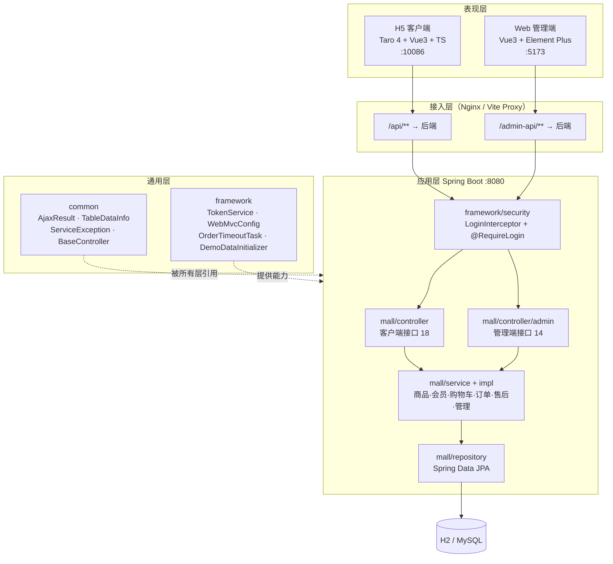
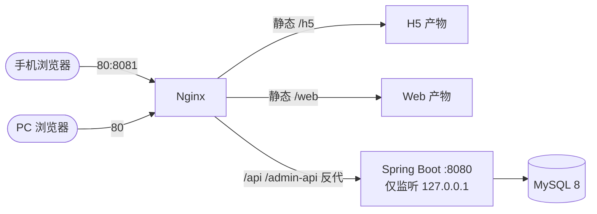
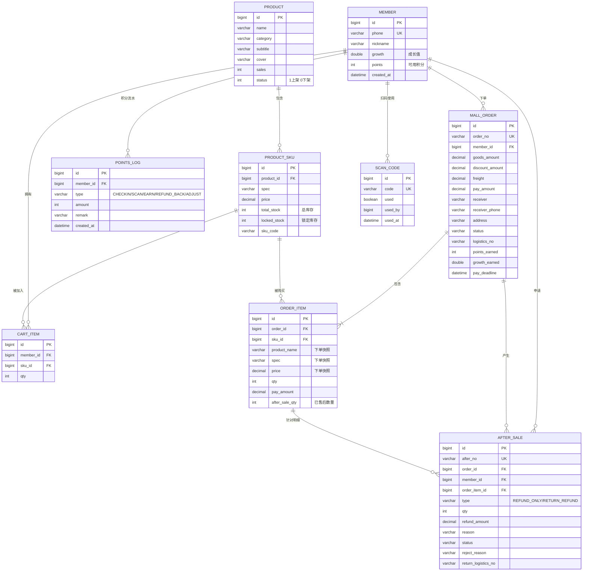

# 02 · 概要设计说明书（HLD）

| 项 | 内容 |
|---|---|
| 文档编号 | QGJ-HLD-02 |
| 版本 | v2.0.0 |
| 日期 | 2026-10-22 |
| 上游 | `01-需求规格说明书.md` |
| 下游 | `03-详细设计/` 四份 |

---

## 1. 设计目标与约束

| 目标 | 落地手段 |
|---|---|
| 两端彻底解耦 | 后端只出 JSON 接口，不再托管任何页面；Web 与 H5 独立工程、独立构建 |
| 后端结构可维护 | 按若依分层：`common`（通用）/ `framework`（框架能力）/ `mall`（业务） |
| 库存绝不超卖 | 数据库条件更新做唯一事实来源，不引入缓存层一致性风险 |
| 本地零依赖可跑 | 默认 H2 内存库，`mysql` profile 切生产库 |
| 换库不改代码 | JPA + 方言自适应，仅 profile 差异 |

**约束**

1. 交付周期短，优先保证主链路闭环，非核心功能（积分兑换、地址簿）可延后。
2. 部署目标为单机 1C2G 云服务器，不引入 Redis、消息队列等中间件。
3. 团队前端以 Vue 为主，管理端复用若依生态降低学习成本。

---

## 2. 总体架构

### 2.1 分层视图



### 2.2 部署视图



开发环境不经过 Nginx：H5 直连 `localhost:8080`，Web 走 Vite proxy（`/admin-api → localhost:8080`）。

### 2.3 代码组织

```
qingguoji-mall/
├── backend/                       # Spring Boot 3.5.6 / Java 21（73 个 java 文件）
│   └── src/main/java/com/qingguoji/mall/
│       ├── common/                # 通用能力，不依赖业务
│       │   ├── constant/          # Constants · HttpStatus
│       │   ├── core/controller/   # BaseController（getDataTable / buildPageRequest）
│       │   ├── core/domain/       # AjaxResult
│       │   ├── core/page/         # TableDataInfo
│       │   ├── exception/         # ServiceException · GlobalExceptionHandler
│       │   └── utils/             # StringUtils
│       ├── framework/             # 框架能力，可移植到其他项目
│       │   ├── config/            # WebMvcConfig · DemoDataInitializer
│       │   ├── security/          # LoginInterceptor · LoginHelper · LoginUser · @RequireLogin
│       │   ├── task/              # OrderTimeoutTask（超时订单）
│       │   └── web/service/       # TokenService
│       └── mall/                  # 业务
│           ├── controller/        # 客户端 5 个
│           ├── controller/admin/  # 管理端 7 个
│           ├── domain/            # 9 个实体 + dto + vo
│           ├── repository/        # 9 个 JPA 仓储
│           └── service/impl/      # 6 个服务
├── frontend-web/                  # Web 管理端（若依风格，59 个源文件）
├── frontend-h5/mall-client/       # H5 客户端（Taro 4）
├── deploy/                        # Dockerfile · compose · nginx · systemd · 打包脚本
├── specs/                         # SDD 文档（本目录）
└── docs/mall-prototype.html       # 交互原型（不参与运行）
```

---

## 3. 技术选型

| 层 | 选型 | 版本 | 理由 | 备选与放弃原因 |
|---|---|---|---|---|
| 运行时 | JDK | 21 (LTS) | Spring Boot 3.x 最低要求 17，21 为当前 LTS | JDK 8：Boot 3 不支持 |
| 框架 | Spring Boot | 3.5.6 | 生态成熟，团队熟悉 | Quarkus：资料少 |
| 持久层 | Spring Data JPA | 随 Boot | 单表 CRUD 零 SQL；`@Query` 可写条件更新 | MyBatis-Plus：条件更新与乐观锁要手写，JPA 更省 |
| 开发库 | H2（MODE=MySQL） | 随 Boot | 免安装、启动即用，语法贴近 MySQL | MySQL：本地要多装服务，违背"零依赖可跑" |
| 生产库 | MySQL | 8.x | 通用、运维成本低 | PostgreSQL：团队不熟 |
| 管理端框架 | Vue 3 | 3.5.26 | Composition API + `<script setup>` | React：团队不熟 |
| 管理端 UI | Element Plus | 2.13.1 | 若依同款，表格/表单开箱即用 | Ant Design Vue：组件风格与若依不同 |
| 管理端构建 | Vite | 6.4.1 | 冷启动秒级，HMR 快 | Webpack：配置重、慢 |
| 状态管理 | Pinia | 3.0.4 | Vue 官方推荐，TS 友好 | Vuex：已停止演进 |
| 请求库 | axios | 1.13.2 | 拦截器机制便于统一加 token / 处理 401 | fetch：需自行封装 |
| 客户端框架 | Taro | 4.x | 一套代码可编译 H5 与微信小程序，符合后续扩展 | 纯 Vue H5：小程序端要重写 |
| 格式门禁（后端） | Spotless + google-java-format AOSP | 2.44.2 | 4 空格缩进贴近若依，`mvn verify` 自动卡口 | Checkstyle：只检查不修复 |
| 格式门禁（前端） | ESLint 9 flat + Prettier | 9.17.0 / 3.4.2 | flat config 是 ESLint 9 标准 | TSLint：已废弃 |
| 单测 | Vitest | 3.2.4 | 与 Vite 同源，无需额外转译 | Jest：ESM 支持差 |
| E2E | Puppeteer | 24.10.0 | 直接控制真实 Chromium，能验 DOM 与网络 | Cypress：体积大、CI 配置复杂 |

---

## 4. 模块划分与职责

### 4.1 后端服务划分

| 服务接口 | 职责 | 依赖 |
|---|---|---|
| `IProductService` | 商品查询、上下架、SKU 列表、库存四原语 | `ProductRepository` `ProductSkuRepository` |
| `IMemberService` | 登录注册、会员查询、签到、扫码、积分增减与流水 | `MemberRepository` `PointsLogRepository` `ScanCodeRepository` |
| `ICartService` | 购物车增改查（组装商品信息为 VO） | `CartRepository` `ProductSkuRepository` `ProductRepository` |
| `IOrderService` | 下单（预占）、支付（扣减+发积分）、取消（释放）、发货、收货、超时扫描 | 上述多个 + `IMemberService` |
| `IAfterSaleService` | 售后申请、审核、填退货物流、确认收货退款、积分回滚 | `IProductService` `IMemberService` |
| `IAdminService` | 管理员登录、看板聚合 | `TokenService` + 各仓储 |

**拆分依据**：按业务能力切，不按技术层切。原来单个 `MallService`（501 行）做 5 件事，导致任何修改都要通读全文；拆分后每个实现 100~180 行，改动面收敛。

### 4.2 前端模块划分

| 工程 | 层次 | 说明 |
|---|---|---|
| `frontend-web` | `views` | 7 个页面，只做展示与交互 |
| | `api` | 一个业务一个文件，做参数适配（`pageNum→page`） |
| | `store` | `user`（token/身份）、`permission`（动态路由）、`app`（侧栏折叠）、`settings` |
| | `utils` | `request`（axios 实例）、`auth`（Cookie）、`format`、`validate`、`dict` |
| | `layout` | Sidebar / Navbar / Breadcrumb / TagsView / AppMain |
| `frontend-h5` | `pages` | 5 个页面（首页/详情/购物车/订单/我的） |
| | `api.ts` | 单文件封装 18 个接口 + token 存取 |
| | `app.config.ts` | 页面注册 + 底部 tabBar |

---

## 5. 数据模型

### 5.1 ER 图



### 5.2 表设计要点

| 设计点 | 说明 |
|---|---|
| `order_item` 冗余商品快照 | 商品改价/改名后，历史订单金额与名称不能被篡改 |
| `order_item.after_sale_qty` | 累计已售后数量，用于校验"不超过购买数量"（A-03），避免反复扫售后单 |
| `product_sku` 双库存字段 | `total_stock` 与 `locked_stock` 分离，可售为派生值，不做冗余存储以免不一致 |
| `member.growth` 用 `double` | 成长值 = 实付金额，需要小数；等级门槛为整数比较 |
| `mall_order.points_earned` / `growth_earned` | 退款时按比例扣回需要知道"当初发了多少"，不能从当前积分反推 |
| 无 `stock_flow` 表 | 库存调整留痕当前只写日志（S-06 部分实现），已列入变更候选 |
| 索引 | `order_no` / `after_no` / `phone` / `scan_code.code` 唯一索引；外键字段建普通索引 |

---

## 6. 关键设计决策

### ADR-01 前后端彻底分离，后端不托管页面

**背景**：初版把管理端写成单个 `admin.html` 放在 `static/` 下，由后端同源托管。
**问题**：改一行样式要重启 Java 服务；无法用组件化与构建工具；代码与后端混杂，前端开发者必须动后端目录。
**决策**：拆出 `frontend-web` 独立工程，后端删除 `static/` 目录。
**代价**：开发时多一个进程、生产要多配一条 Nginx 规则。
**结论**：值得。E2E 能独立跑，前端改动不再触碰后端。

### ADR-02 库存用数据库条件更新，不引入 Redis 预扣

**背景**：原需求 S-05 写的是「Redis 预扣 + DB 兜底」。
**决策**：只保留 DB 条件更新：
```sql
UPDATE product_sku SET locked_stock = locked_stock + :qty
WHERE id = :skuId AND (total_stock - locked_stock) >= :qty
```
受影响行数为 0 即为库存不足，事务回滚。
**理由**：单机日订单量级在千级，DB 行锁完全够用；引入 Redis 会带来"缓存与库不一致"的新问题，且当前项目根本没装 Redis（原 `pom.xml` 引了依赖但零使用）。
**代价**：并发能力受单库写入限制。
**何时重审**：QPS 上千或需要多实例时，再引入 Redis + 最终一致对账。

### ADR-03 令牌存进程内存，暂不上 JWT

**背景**：需求 U-02 写的是 JWT 7 天有效期。
**决策**：`TokenService` 用 `ConcurrentHashMap` 存 `token → 主体`，令牌加前缀区分身份。
**理由**：单机演示场景，无需跨实例验签；省掉密钥管理与续期逻辑，代码量从 ~150 行降到 ~60 行。
**代价**：重启后全部登出；无法水平扩展；无过期时间。
**缓解**：接口方法签名（`createToken` / `getMemberId` / `adminLogin` / `getAdminName`）已按 JWT 形态设计，替换时只改实现类，Controller 无需变动。

### ADR-04 管理端照搬若依的目录与交互

**理由**：若依是国内后台管理的事实标准，表格 + 搜索区 + 分页 + 标签页的交互用户熟悉；`request.js` / `permission.js` / `auth.js` 的写法可以直接复用社区经验。
**适配**：token 请求头改为 `X-Token`（后端约定），无 `/getInfo`、`/getRouters` 接口，故用「登录后拉看板接口验活 + 前端静态路由表按角色注入」替代。详见 03-3 第 2 章。

### ADR-05 客户端接口保持 Spring Page 结构，管理端用 TableDataInfo

**背景**：H5 的 `api.ts` 消费 `res.data.content`，管理端若依习惯 `{ rows, total }`。
**决策**：`/api/**` 返回 `Page<T>`（`content/totalElements`），`/admin-api/**` 返回 `TableDataInfo`（`rows/total`）。
**理由**：不动已跑通的 H5 代码；管理端在 `utils/request.js#unwrapPage` 里双兼容，将来任一端改契约都不影响另一端。

### ADR-06 演示数据用代码初始化，不用 SQL 脚本

`DemoDataInitializer` 在启动时检查商品表是否为空，为空则灌 10 个商品 + 30 个防伪码。
**理由**：H2 与 MySQL 语法差异（自增、时间函数）会让同一份 SQL 脚本两边都跑不通；用 JPA 保存实体则天然兼容。
**控制**：`DEMO_DATA=false` 可关闭，生产环境必须关闭。

---

## 7. 非功能设计

### 7.1 鉴权设计

```
请求 → LoginInterceptor
         ├─ 无 @RequireLogin → 放行（登录接口、商品浏览）
         ├─ @RequireLogin(ADMIN) → 校验 ADM- 令牌 → LoginHelper.setLoginUser(admin)
         └─ @RequireLogin(MEMBER) → 校验 MBR- 令牌 → LoginHelper.setLoginUser(member)
       → Controller 内 getMemberId() 取当前用户
       → afterCompletion 清理 ThreadLocal
```

令牌无效时返回 **HTTP 200 + body `{code:401}`**（与若依一致，便于前端统一在响应拦截器处理）。

### 7.2 统一响应

```json
{ "code": 200, "msg": "操作成功", "data": {...} }
```

错误码约定：`200` 成功 · `400` 参数/业务校验失败 · `401` 未登录或令牌失效 · `500` 服务异常。

### 7.3 异常处理

`GlobalExceptionHandler` 捕获三类：

| 异常 | 返回 | 日志级别 |
|---|---|---|
| `ServiceException`（业务校验） | code 400 + 原始提示 | warn |
| `MethodArgumentNotValidException`（参数绑定） | code 400 + 首个字段错误 | warn |
| 其他 `Exception` | code 500 + "系统繁忙，请稍后重试" | error（含堆栈） |

**原则**：业务异常文案直接面向用户，必须是可读中文；系统异常不暴露堆栈给前端。

### 7.4 分页约定

| 端 | 请求参数 | 响应结构 |
|---|---|---|
| 客户端 `/api/**` | `page`（从 0 开始）、`size` | Spring `Page`：`content` / `totalElements` / `totalPages` |
| 管理端 `/admin-api/**` | `page`（从 0 开始）、`size` | `{ code, msg, rows, total }` |

管理端前端习惯用 `pageNum`（从 1 开始），在 `api/page.js#buildPageParams` 里转换。

### 7.5 定时任务

`OrderTimeoutTask` 每 30 秒扫描 `status = WAIT_PAY AND pay_deadline < now()` 的订单，逐单释放库存并置为 `CANCELED`。

**已知局限**：单实例 `@Scheduled`，多实例会重复执行。当前靠订单状态判断做幂等（非 `WAIT_PAY` 直接返回），重复执行不会二次释放。

---

## 8. 需求到设计的映射

| 需求域 | 主要设计章节 | 核心代码 |
|---|---|---|
| U / V 会员与积分 | 5.1 表设计、7.1 鉴权 | `MemberServiceImpl` `TokenService` |
| P / S 商品与库存 | ADR-02、5.2 | `ProductServiceImpl` `ProductSkuRepository` |
| C 购物车 | 4.1 | `CartServiceImpl` |
| O 订单 | ADR-03、7.5、01 文档 5.1 | `OrderServiceImpl` `OrderTimeoutTask` |
| A 售后 | 01 文档 5.2 | `AfterSaleServiceImpl` |
| M 管理端接口 | ADR-05、7.4 | `controller/admin/*` |
| W 管理端页面 | ADR-04 | `frontend-web/src` |
| H5 客户端 | ADR-05 | `frontend-h5/src` |

---

*详细类设计、接口签名、页面组件拆解见 `03-详细设计/`。*
