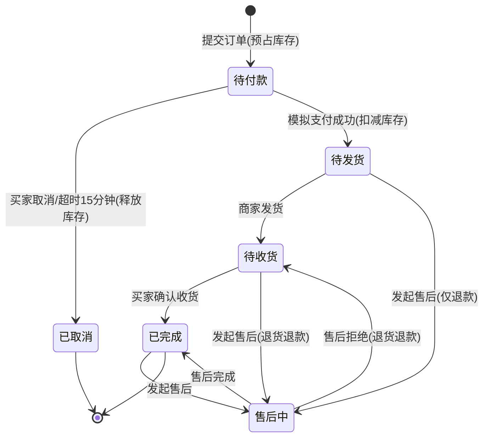
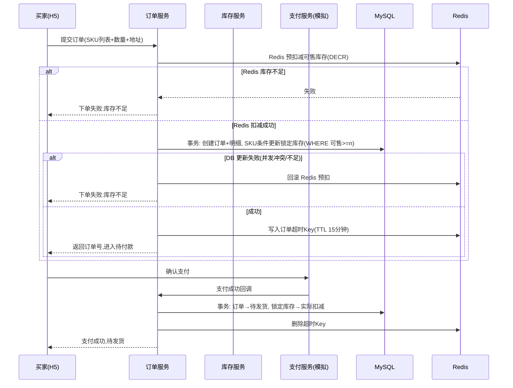
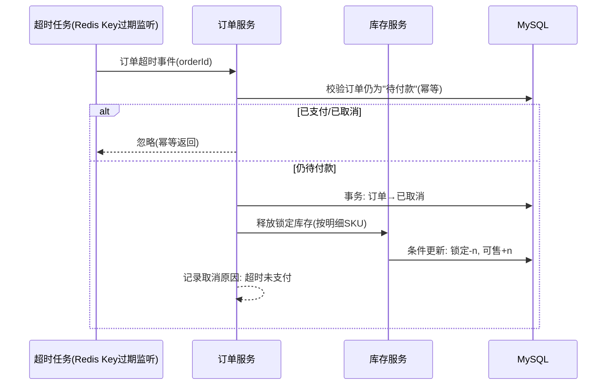
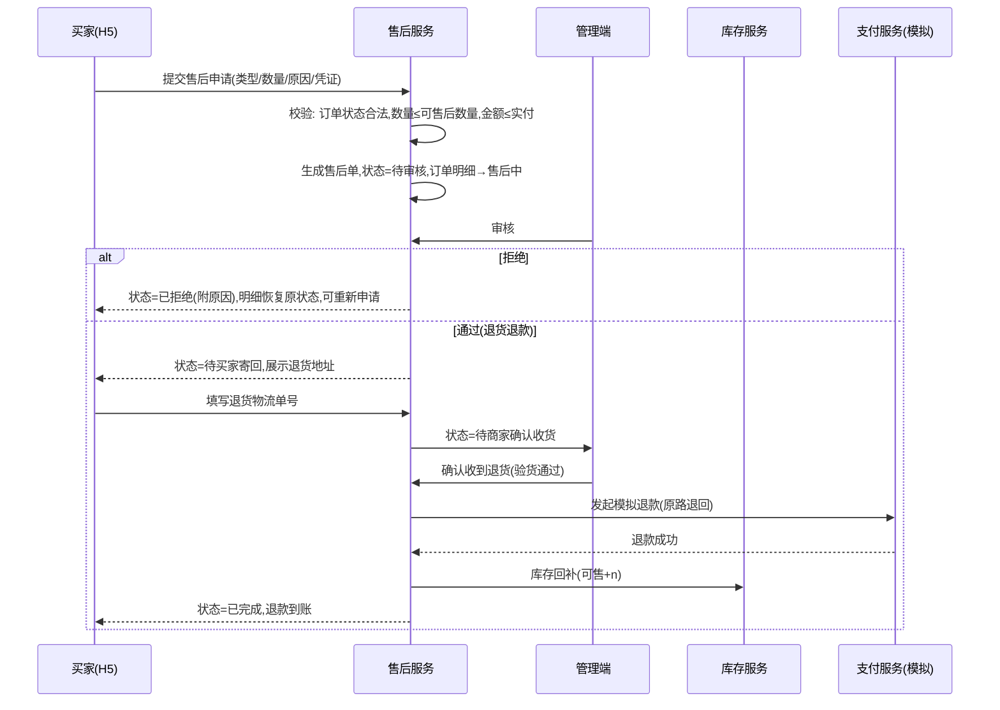

# 槟榔品牌会员商城系统需求规格说明书（SPEC）—— H5 客户端 + Web 管理端

| 项 | 内容 |
|---|---|
| 文档版本 | v2.0.0（change-007：补齐 Web 管理端页面级需求与双端全链路业务流程） |
| 状态 | 基线（Baseline） |
| 日期 | 2026-10-22 |
| 对标产品 | 有赞 SaaS 商城（客户端）、若依 RuoYi（管理端交互风格） |
| 技术栈（实际落地） | 后端 Spring Boot 3.5.6 + JPA + H2/MySQL；客户端 H5：Taro 4 + Vue3；管理端 Web：若依风格单页应用（admin.html，后端同源托管） |
| 双端范围 | **H5 客户端**（买家：浏览/加购/下单/支付/售后/会员）；**Web 管理端**（商家：看板/商品/库存/订单/售后/会员管理） |

---

## 1. 项目背景与目标

### 1.1 背景
为中小商家提供一套轻量级 H5 电商解决方案，覆盖"浏览商品 → 加购 → 下单支付 → 收货 → 售后退单"的完整电商闭环，并提供管理端对商品、订单、库存、售后进行统一管理。

### 1.2 项目目标（最初目标，用于结项对照）
1. 客户端（H5）支持完整购物链路：注册登录、商品浏览/搜索、购物车、下单支付（模拟支付）、订单管理、售后退单。
2. 管理端支持：商品管理、库存管理、订单管理、售后审核、基础数据看板。
3. 库存不超卖：高并发下单场景下库存扣减准确。
4. 交付完整 SDD 产物：SPEC（含 3-5 次 change 记录）、代码仓库、测试用例、测试报告、可演示系统。

### 1.3 范围
- **做**：客户端 H5（移动端浏览器/微信内嵌风格）、管理端（PC Web）、模拟支付、库存预占与释放、售后退单。
- **不做**：真实支付网关对接（微信/支付宝沙箱仅预留接口）、物流对接（物流单号手工录入）、多租户、优惠券营销（列入后续 change 候选）。

---

## 2. 角色与权限

| 角色 | 端 | 能力 |
|---|---|---|
| 游客 | 客户端 H5 | 浏览商品、搜索；加购/下单时引导登录 |
| 买家 | 客户端 H5 | 收货地址管理、购物车、下单支付、取消订单、确认收货、申请售后、查看售后进度 |
| 商家管理员 | 管理端 | 商品上下架与 SKU/价格维护、库存调整、订单发货、售后审核与退款、数据看板 |
| 超级管理员 | 管理端 | 商家管理员全部能力 + 管理员账号管理（本期可简化为单一管理员账号） |

---

## 3. 功能需求

### 3.1 用户模块（客户端）

| 编号 | 功能 | 需求描述 |
|---|---|---|
| U-01 | 注册/登录 | 手机号 + 短信验证码登录（验证码模拟固定为 `123456`，接口预留真实短信网关）；新手机号自动注册 |
| U-02 | 登录态 | JWT Token，有效期 7 天；刷新机制预留 |
| U-03 | 个人信息 | 昵称、头像（默认头像）、手机号展示 |
| U-04 | 收货地址 | 增删改查；字段：收货人、手机号、省市区、详细地址、是否默认；下单时选择，同一时间仅一个默认地址 |

### 3.2 商品模块

| 编号 | 功能 | 需求描述 |
|---|---|---|
| P-01 | 商品分类 | 两级分类（如：数码/手机、数码/耳机）；管理端维护 |
| P-02 | 商品列表 | 客户端首页：轮播图（运营位）+ 分类导航 + 商品瀑布流；支持按销量/价格/上架时间排序 |
| P-03 | 商品搜索 | 按商品名称模糊搜索；结果页复用商品列表 |
| P-04 | 商品详情 | 主图轮播、标题、卖点、价格区间（SKU）、销量、详情图文（富文本）、规格选择 |
| P-05 | SKU 规格 | 商品含多规格（如颜色×内存）；每个 SKU 独立价格、库存、商品编码；选中规格联动价格与库存显示 |
| P-06 | 上下架 | 仅上架商品对客户端可见；下单时后端二次校验上架状态 |

### 3.3 购物车模块

| 编号 | 功能 | 需求描述 |
|---|---|---|
| C-01 | 加购 | 从商品详情选择 SKU + 数量加入购物车；同一 SKU 合并数量 |
| C-02 | 查看 | 列表展示：商品图、标题、选中规格、单价、数量小计；失效商品（下架/删改）单独分组置灰 |
| C-03 | 修改 | 修改数量（步进器）、删除、全选/单选 |
| C-04 | 结算 | 按勾选商品结算；结算页实时计算：商品总额、运费（满 99 免运费，否则 8 元）、应付总额 |
| C-05 | 存储 | 登录用户购物车存服务端（Redis + DB 持久化），多端同步 |

### 3.4 订单模块

| 编号 | 功能 | 需求描述 |
|---|---|---|
| O-01 | 订单创建 | 从购物车勾选项或商品详情"立即购买"进入确认订单页 → 提交订单；生成订单号（规则：`yyyyMMdd` + 12 位序列）；一个订单可含多个商品明细（立即购买为单商品） |
| O-02 | 库存预占 | 提交订单时预占库存（见 5.2），预占失败（库存不足）则下单失败并提示 |
| O-03 | 模拟支付 | 订单生成后 15 分钟内支付（倒计时展示）；支付为模拟收银台页，点击"确认支付"即成功 |
| O-04 | 订单状态机 | 见 5.1 状态机定义 |
| O-05 | 取消订单 | 待付款状态下买家可主动取消；超时 15 分钟未支付系统自动取消；两种取消均释放预占库存 |
| O-06 | 订单列表 | 状态 Tab：全部/待付款/待发货/待收货/已完成/售后中 |
| O-07 | 确认收货 | 待收货状态下买家确认收货 → 已完成；超 15 天自动确认（预留定时任务） |
| O-08 | 发货 | 管理端对待发货订单录入物流公司 + 物流单号后发货（物流跟踪本期仅展示单号） |

### 3.5 库存模块（防超卖核心）

| 编号 | 功能 | 需求描述 |
|---|---|---|
| S-01 | 库存结构 | 库存挂在 **SKU 维度**；字段：总库存、锁定库存（预占中）、可售库存 = 总库存 − 锁定库存 |
| S-02 | 预占 | 提交订单锁定对应 SKU 数量；同一订单内多 SKU 需**原子性**预占（任一不足则全部失败） |
| S-03 | 扣减确认 | 支付成功后，锁定库存转为实际扣减（总库存减少） |
| S-04 | 释放 | 订单取消/支付超时后，锁定库存释放回可售库存 |
| S-05 | 防超卖 | 数据库乐观锁（`version` 字段或 `WHERE stock >= n` 条件更新）+ Redis 预扣减；并发压测下不超卖 |
| S-06 | 库存管理 | 管理端可查看各 SKU 库存、手动调整库存（调整记录留痕：操作人/时间/变更量/原因） |
| S-07 | 售后回补 | 退货退款完成后，库存自动回补（可配置：合格品回可售库存） |

### 3.6 售后模块（退单）

| 编号 | 功能 | 需求描述 |
|---|---|---|
| A-01 | 申请入口 | 已支付（待发货/待收货）及已完成订单，可按订单明细行申请售后 |
| A-02 | 售后类型 | ① **仅退款**（未收货：待发货阶段，无需退回货物）② **退货退款**（已收货/已完成阶段，需退回货物） |
| A-03 | 申请内容 | 退货数量（≤ 该明细行购买数量 − 已售后数量）、退款金额（默认按比例，单价×数量）、售后原因（枚举：七天无理由/质量问题/描述不符/发错货/其他）、补充描述与凭证图片（≤3 张） |
| A-04 | 售后状态机 | 见 5.3 |
| A-05 | 商家审核 | 管理端审核通过 → 进入退款/退货执行；拒绝 → 需填写拒绝原因，买家可查看并可重新申请 |
| A-06 | 仅退款执行 | 审核通过后模拟退款到账（原路退回提示），售后完成，库存不回补（未发货无货可回） |
| A-07 | 退货退款执行 | 审核通过 → 买家寄回并填写退货物流单号 → 商家确认收货并验货 → 模拟退款到账 → 库存回补 → 售后完成 |
| A-08 | 取消售后 | 买家在商家审核前可撤销售后申请 |
| A-09 | 金额约束 | 单行明细累计退款金额 ≤ 实付金额；售后中的明细不可重复发起申请 |

### 3.7 会员模块（V-01~V-07，v1.1.0 change-001 新增，参考正隆记）

| 编号 | 功能 | 需求描述 |
|---|---|---|
| V-01 | 会员等级 | 五级体系：注册会员(0) → 铜卡(1,000) → 银卡(5,000) → 金卡(20,000) → 黑金卡(50,000)；成长值=累计消费金额（1 元 = 1 成长值），只增不减，退款时按比例扣回 |
| V-02 | 等级权益 | 折扣：银 95 折 / 金 9 折 / 黑金 85 折；积分倍率：铜 1.2 / 银 1.5 / 金 2.0 / 黑金 2.5；金卡及以上：生日礼盒、新品优先购；黑金卡：专属客服 |
| V-03 | 消费积分 | 支付成功后按 `实付金额 × 等级倍率` 发放积分（取整）；订单完成（确认收货）后积分转"可用"状态 |
| V-04 | 扫码积分 | 每包产品内含唯一防伪码，扫码 +10 积分并验真；同一码仅可积分一次；每人每日上限 20 包 |
| V-05 | 每日签到 | 每日签到 +5 积分，连续签到 7 天额外 +50；按自然周展示与重置 |
| V-06 | 积分兑换 | 积分商城：槟榔产品/品牌周边/权益券；兑换扣减积分并生成兑换订单（走正常发货/售后流程）；金卡专属商品对低等级会员置灰 |
| V-07 | 积分流水 | 积分明细页：获得/扣减/兑换/过期四类流水，来源可追溯（订单号/售后单号/扫码码值） |

### 3.8 管理端（PC Web）

| 编号 | 功能 | 需求描述 |
|---|---|---|
| M-01 | 数据看板 | 今日订单数、今日销售额、待发货订单数、待处理售后数、商品总数、库存预警（可售库存 < 10 的 SKU 列表） |
| M-02 | 商品管理 | 商品列表（搜索/分类筛选/状态筛选）、新建/编辑商品（含 SKU 表格编辑）、上下架、删除（软删） |
| M-03 | 订单管理 | 订单列表（多条件筛选）、订单详情（含支付信息、物流信息、售后信息）、发货操作 |
| M-04 | 售后管理 | 售后列表（状态筛选）、售后详情、审核（通过/拒绝+原因）、确认退货收到 |
| M-05 | 库存管理 | SKU 库存列表、库存调整（带留痕）、库存流水查询 |
| M-06 | 管理员登录 | 账号密码登录，独立于买家登录体系 |
| M-07 | 会员管理 | 会员列表（等级/积分/成长值筛选）、会员详情、积分人工调整（留痕） |
| M-08 | 会员规则配置 | 等级成长值门槛、积分倍率、消费/扫码/签到积分规则可配置 |
| M-09 | 会员数据看板 | 会员总数、各等级分布、今日扫码积分包数、积分发放/消耗统计 |

#### 3.8.1 Web 管理端页面级需求（PC Web，若依 RuoYi 交互风格）

管理端为 PC 浏览器单页应用（admin.html，由后端同源托管于 `/admin.html`），交互风格对标若依后台：深色侧边栏 + 顶部面包屑 + 标签页 + 搜索区（查询/重置）+ Element 风格表格/对话框/分页/消息提示。主色调蓝色（#409EFF）。

**W-L1 整体框架**

| 编号 | 需求 | 描述 |
|---|---|---|
| W-01 | 登录页 | 账号+密码登录；未登录访问任何页面跳转登录页；登录态本地保存，过期自动回登录页并提示"登录已过期" |
| W-02 | 布局框架 | 左侧固定侧栏（Logo + 六个菜单项：首页看板/商品管理/库存管理/订单管理/售后管理/会员管理）；顶栏显示面包屑与当前管理员；点击菜单切换内容区并更新面包屑/标签页 |
| W-03 | 会话安全 | 所有请求携带 X-Token；服务端 401 时前端自动退出登录；退出登录清除本地凭证 |
| W-04 | 操作反馈 | 所有写操作成功/失败均有 toast 提示；破坏性操作（下架、拒绝售后、确认退款）必须经二次确认对话框 |
| W-05 | 分页与筛选 | 各列表页支持条件搜索（商品名称/规格/订单号/订单状态/售后状态/手机号）与重置；数据 >10 条显示分页条 |

**W-L2 数据看板（首页）**

| 编号 | 需求 | 描述 |
|---|---|---|
| W-10 | 核心指标卡 | 展示 6 项指标：今日销售额、今日订单数、待发货订单、待审核售后、会员总数、在售商品；每 30 秒自动刷新 |
| W-11 | 指标口径 | 今日销售额=当日 PAID 及之后状态订单实付合计；待发货=PAID 订单数；待审核售后=WAIT_AUDIT 数 |

**W-L3 商品管理**

| 编号 | 需求 | 描述 |
|---|---|---|
| W-20 | 商品列表 | 列：编号/名称/分类/价格区间/销量/状态（在售·绿 tag/已下架·灰 tag）；按名称搜索 |
| W-21 | 上下架操作 | 点击"上架/下架"弹确认框；下架后 H5 端立即不可见（对应 P-06、AC-07） |

**W-L4 库存管理**

| 编号 | 需求 | 描述 |
|---|---|---|
| W-30 | SKU 库存列表 | 列：SKU 编号/所属商品/规格/单价/总库存/锁定库存/可售库存（可售红色高亮，=总-锁定） |
| W-31 | 库存调整 | 弹窗输入变动数量（正入库/负出库），delta 为 0 或空被拒（对齐 S-06 与参数校验规格）；调整必须留痕（S-06） |

**W-L5 订单管理**

| 编号 | 需求 | 描述 |
|---|---|---|
| W-40 | 订单列表 | 列：订单号/会员/金额/状态 tag（待付款黄/已付款蓝/已发货蓝/已完成绿/已取消灰）/物流单号；支持状态筛选与订单号搜索 |
| W-41 | 发货操作 | 仅 PAID 状态显示"发货"入口；弹窗必填物流单号，空值被拒（O-08）；发货后状态 → SHIPPED |

**W-L6 售后管理**

| 编号 | 需求 | 描述 |
|---|---|---|
| W-50 | 售后列表 | 列：售后单号/类型（仅退款/退货退款）/数量/退款金额/状态 tag/退货物流；支持状态筛选 |
| W-51 | 审核 | WAIT_AUDIT 显示"通过/拒绝"；拒绝弹窗必填原因；通过后仅退款直接完成（DONE），退货退款进入 WAIT_RETURN |
| W-52 | 确认收货 | 仅 WAIT_RECEIVE 状态显示"确认收货并退款"；二次确认后执行退款+库存回补，状态 → DONE；对 WAIT_RETURN 单确认收货被后端拦截 |

**W-L7 会员管理**

| 编号 | 需求 | 描述 |
|---|---|---|
| W-60 | 会员列表 | 列：编号/手机号/昵称/等级 tag（按等级配色）/积分（红）/成长值；支持手机号搜索 |
| W-61 | 积分调整 | 弹窗输入变动积分（正发放/负扣减，0 或空被拒），调整留痕（M-07） |
| W-62 | 积分流水 | 查看单个会员最近积分流水（时间/类型/变动值） |

---

## 4. 非功能需求

| 类别 | 要求 |
|---|---|
| 性能 | 商品列表接口 P95 < 300ms；下单接口 P95 < 500ms；100 并发下单压测不超卖 |
| 安全 | 密码 BCrypt 加密；JWT 鉴权；管理端接口独立权限校验；SQL 注入/越权访问防护 |
| 可用性 | 核心链路（下单/支付/退款）异常有明确用户提示；服务优雅降级（Redis 不可用时回退 DB 乐观锁扣减） |
| 可维护性 | 统一响应体 `{code, message, data}`；全局异常处理；操作日志留痕 |
| 兼容性 | 客户端 H5 兼容 iOS Safari / Android Chrome / 微信内置浏览器 |

---

## 5. 核心设计：状态机与时序图

### 5.1 订单状态机



### 5.2 下单-支付-库存时序图



**库存流转说明**：可售库存 = 总库存 − 锁定库存。下单 → 锁定（+锁定）；支付 → 扣减（总库存与锁定同时减少）；取消/超时 → 释放（−锁定）。

### 5.3 订单超时取消时序图



### 5.4 售后退单时序图（退货退款）



> **仅退款**流程为上述流程的简化：审核通过 → 直接模拟退款 → 售后完成（无寄回、无库存回补）。

### 5.5 库存扣减防超卖要点

1. **Redis 预扣减**挡住绝大部分流量（DECR 原子操作）。
2. **DB 条件更新兜底**：`UPDATE sku SET locked = locked + n WHERE id = ? AND total - locked >= n`，受影响行数为 0 即失败。
3. **事务一致性**：订单创建与库存锁定同一本地事务；Redis 与 DB 不一致时以 DB 为准，Redis 异常时降级为纯 DB 扣减。
4. **幂等**：支付回调、超时取消均以订单状态前置校验保证幂等，重复通知不产生二次扣减。

---

## 6. 全链路业务流程（H5 客户端 × Web 管理端）

> 本章描述两条端到端主链路与三条双端协作链路。每个环节标注执行端（**H5**=买家客户端 / **Web**=商家管理端 / **后端**=服务），以及业务状态流转。验收标准见第 7 章 AC。

### 6.1 买家全链路（H5 主链路）

```
注册登录 → 浏览首页 → 商品详情 → 加入购物车 → 购物车结算 → 确认订单 → 模拟支付
    │                                                            │
    │（15 分钟未支付）                                             ├─ 支付成功 → 等待发货 → 确认收货 → 完成
    └→ 订单超时自动取消（库存释放）                                  └─ 申请售后 → 退款/退货 → 完成
```

| # | 环节 | 执行端 | 行为与规则 | 状态/数据变化 |
|---|---|---|---|---|
| 1 | 注册登录 | H5 | 手机号+验证码（演示固定 123456）；新号自动注册；手机号格式校验 | 生成会员（注册等级，1.0 倍积分） |
| 2 | 签到/扫码 | H5 | 每日签到 +5（连续 7 天 +50）；扫包装防伪码 +10/包，日限 20 包，码防重 | 积分流水留痕（CHECKIN / SCAN） |
| 3 | 浏览/详情 | H5 | 首页商品流（销量倒序）；详情含 SKU 规格、可售库存、会员折扣提示 | 仅在售商品可见 |
| 4 | 加购 | H5 | 同 SKU 合并数量；qty 限 1~999；下架商品不可加购 | 购物车项数量更新 |
| 5 | 结算下单 | H5 | 会员折扣计算、满 99 免运费（否则 +8）；收件三字段必填 | **订单 WAIT_PAY；库存预占锁定（S-02）** |
| 6 | 支付 | H5 | 15 分钟倒计时；模拟支付；幂等防重复支付 | **PAID；锁定→实扣；发积分（实付×等级倍率）；成长值累计** |
| 6a | 超时分支 | 后端 | 定时任务扫过期 WAIT_PAY 订单 | **CANCELED；锁定库存释放** |
| 7 | 收货 | H5 | 确认收货（幂等，仅一次） | **COMPLETED** |
| 8 | 售后 | H5 | 见 6.3 / 6.4 双端协作链路 | 见售后状态机 |

### 6.2 商家全链路（Web 管理端主链路）

```
登录 → 数据看板（今日概况）→ 商品上架 → 库存补充 → 订单发货 → 售后审核/确认收货 → 会员运营（积分调整）
```

| # | 环节 | 执行端 | 行为与规则 | 状态/数据变化 |
|---|---|---|---|---|
| 1 | 登录 | Web | 账号密码独立登录体系（admin）；401 自动回登录页 | 获得 adminToken |
| 2 | 看板 | Web | 6 项核心指标，30 秒自刷新 | — |
| 3 | 商品管理 | Web | 上架/下架（二次确认） | 下架商品 H5 立即不可见（P-06） |
| 4 | 库存管理 | Web | 调整 delta≠0，留痕操作人/时间/原因 | 总库存变动，流水入库 |
| 5 | 订单发货 | Web | 仅 PAID 可发货，必填物流单号 | **SHIPPED**，买家 H5 可见物流单号 |
| 6 | 售后处理 | Web | 审核（拒绝必填原因）/确认收货（见 6.3、6.4） | 见售后状态机 |
| 7 | 会员运营 | Web | 查看等级/积分；人工调整积分（留痕）；查流水 | 积分变动入库 |

### 6.3 双端协作链路一：仅退款（REFUND_ONLY）

```
H5:申请(WAIT_AUDIT) → Web:审核 ─┬─ 拒绝(填原因) → REJECTED，买家可重新申请
                                └─ 通过 → 模拟退款到账 → DONE
                                          （无库存回补；积分按退款比例扣回，REFUND_BACK 流水）
```

**约束**：仅退款只允许 PAID（未发货）订单；已发货/已完成订单仅支持退货退款（A-02）；退款金额=按明细实付比例计算，不超实付。

### 6.4 双端协作链路二：退货退款（RETURN_REFUND，四段式跨端流转）

```
H5:申请 → [WAIT_AUDIT]
Web:审核通过 → [WAIT_RETURN]（展示退货地址）
H5:填写退货物流单号（必填） → [WAIT_RECEIVE]
Web:确认收货（二次确认） → 模拟退款 + 库存回补(可售+n) + 积分扣回 → [DONE]
```

**状态机约束**：未寄回时商家不可确认收货；寄回前填空物流单号被拒；每一步仅允许对应状态触发（非法流转统一拦截）。

### 6.5 双端协作链路三：积分与会员成长

```
消费支付(H5) ──→ 发积分 = 实付 × 等级倍率；成长值 + 实付
扫码/签到(H5) ─→ 防伪码积分（防重 + 日限 20 包）；签到 5/天，连续 7 天 +50
售后退款(Web 审核触发) → 扣回 = round(已发积分 × 退款额 ÷ 实付)，成长值同步扣减
成长值累计跨端可查(H5 会员中心 / Web 会员管理) → 达到门槛自动升级（注册→铜→银→金→黑金），折扣与倍率即时生效
```

| 等级 | 成长值门槛 | 折扣 | 积分倍率 |
|---|---|---|---|
| 注册会员 | 0 | 无 | 1.0 |
| 铜卡 | 1,000 | 无 | 1.2 |
| 银卡 | 5,000 | 95 折 | 1.5 |
| 金卡 | 20,000 | 9 折 | 2.0 |
| 黑金卡 | 50,000 | 85 折 | 2.5 |

### 6.6 全链路验收主线（演示脚本）

端到端演示按此脚本走通即为需求闭环：**Web** 上架商品 → **H5** 登录→加购→下单 → **H5** 支付（积分到账）→ **Web** 看板销售额+1、订单发货 → **H5** 确认收货 → **H5** 申请退货退款 → **Web** 审核通过 → **H5** 填退货物流 → **Web** 确认收货（退款+库存回补+积分扣回）→ 双端数据一致。

---

## 7. 验收标准（节选，测试用例由此派生）

| 编号 | 验收标准（Given-When-Then） |
|---|---|
| AC-01 | Given 可售库存为 1 的 SKU，When 两个用户并发下单各 1 件，Then 仅 1 单成功，另 1 单收到"库存不足"提示，且库存数据无负数 |
| AC-02 | Given 一笔待付款订单，When 15 分钟内未支付，Then 订单自动变为已取消，且锁定库存被释放、可售库存恢复 |
| AC-03 | Given 一笔待付款订单，When 买家支付成功，Then 订单变为待发货，SKU 总库存与锁定库存同步减少 |
| AC-04 | Given 待发货订单包含 2 件商品，When 买家对其中 1 件申请仅退款并通过审核，Then 退款金额=该 SKU 实付金额，另一件商品与订单状态不受影响 |
| AC-05 | Given 待收货订单，When 买家申请退货退款→商家通过→买家寄回→商家确认收货，Then 模拟退款到账、库存回补、售后单完成 |
| AC-06 | Given 满足满 99 免运费的购物车结算，When 提交订单，Then 运费为 0 且订单金额计算正确 |
| AC-07 | Given 已下架商品，When 客户端访问其详情或尝试下单，Then 详情不可见/下单被拦截并提示 |
| AC-08 | 管理端所有变更操作（改价、调库存、审核售后）均留痕（操作人、时间、前后值） |
| AC-09 | Given 银卡会员（1.5 倍积分、95 折）实付 ¥47.50 下单，When 支付成功，Then 发放积分 = round(47.5×1.5)=71，成长值 +47.5，订单金额按 95 折计算 |
| AC-10 | Given 同一防伪码已积分成功，When 再次扫码，Then 提示"该码已使用"且积分不重复发放；Given 当日已扫满 20 包，When 继续扫码，Then 提示超上限 |
| AC-11 | Given 银卡会员成长值 6,200，When 累计消费成长值达到 20,000，Then 等级自动升为金卡并生效金卡权益（9 折、2 倍积分） |
| AC-12 | Given 订单支付后发放积分 71，When 整单退款完成，Then 扣回 71 积分与对应成长值；部分退款按退款金额比例扣回 |
| AC-13 | Given 金卡专属兑换商品，When 注册会员尝试兑换，Then 按钮置灰且接口拦截；Given 积分不足，When 兑换，Then 提示积分不足 |
| AC-14 | Given 连续签到第 7 天，When 当日签到，Then 发放 5+50=55 积分，周重置后连续计数重新开始 |
| AC-15 | Given 未登录状态，When 访问 Web 管理端任意页面，Then 跳转登录页；Given 错误凭证，When 登录，Then 拒绝并提示；Given 登录过期，When 发起任何操作，Then 自动退出并提示重新登录 |
| AC-16 | Given WAIT_RETURN 状态售后单，When 商家在 Web 端未收到退货时点确认收货，Then 被拦截；When 买家填空物流单号，Then 提示"退货物流单号不能为空"；完整走完 6.4 四段流转后，Then 退款到账、可售库存 +n、积分按比例扣回 |
| AC-17 | Given H5 客户端 api.ts 声明的全部接口，When 运行契约对账测试，Then 每个接口均被 E2E 真实执行且行为一致（无契约漂移）；Web 管理端调用的 14 个 admin-api 接口全部可用 |

---

## 8. Change 管理

SPEC 基线为 v1.0.0。后续变更（如新增优惠券、对接真实支付沙箱、物流查询）必须以 change 记录形式归档至 `specs/changes/`，每次 change 包含：变更动机、变更内容、影响范围、版本号递增。项目结项时 SPEC 仓库应包含 **3-5 次 change** 记录（考评要求）。

---

*本文档为 SDD 流程的唯一需求事实来源（Single Source of Truth），覆盖 H5 客户端与 Web 管理端双端；后续 plan.md、tasks.md、测试用例均需引用本文档编号（如 U-01、O-03、A-04、W-30、AC-01）。*
